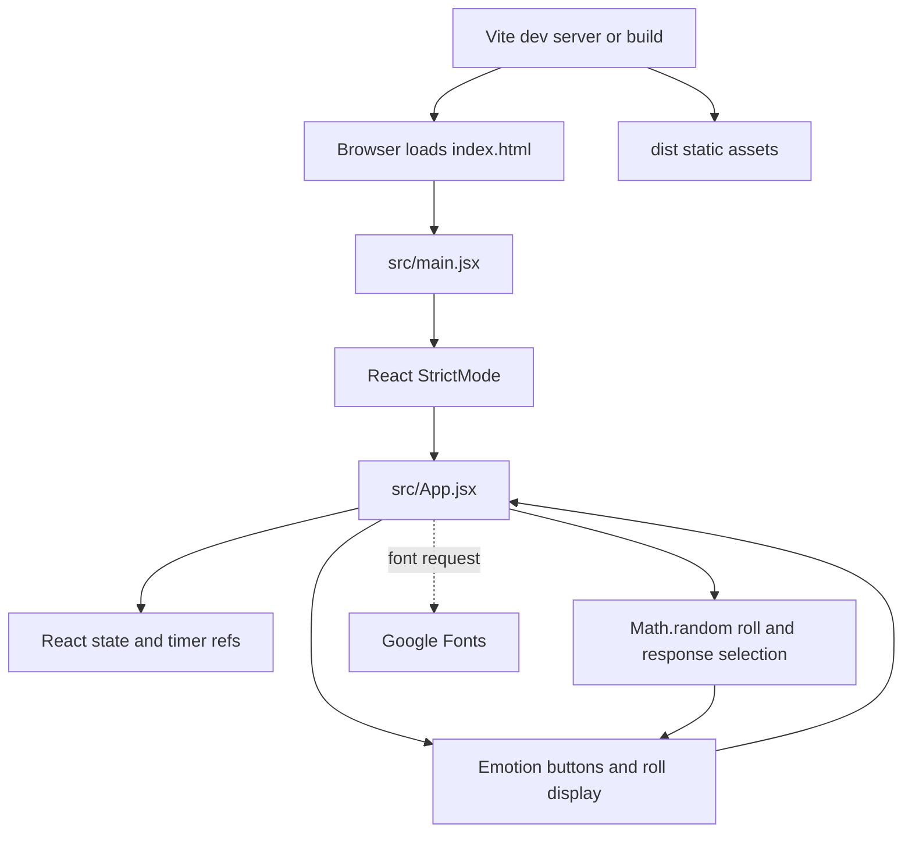

# askmouse Architecture

## 1. Overview

askmouse is a small browser-based yes-or-no fortune toy: a visitor can choose one of five feelings and roll for a randomized response. The selected feeling changes the probability of a yes; leaving all feelings unselected gives a 50/50 chance. It is intended for casual entertainment, not advice, and the code does not collect a question. The repository contains a working Vite/React app and production build command; whether it is deployed or actively maintained is unclear.

## 2. Tech Stack

Versions below are resolved versions from `package-lock.json` where available. A package.json range is noted when the lockfile resolves an exact version.

| Layer | Technology | Version | Purpose |
| --- | --- | --- | --- |
| Language | JavaScript (ES modules and JSX) | No project version or runtime is pinned | App and configuration source. |
| Framework | React and React DOM | 19.2.8 | Renders the browser UI. |
| UI | React elements, inline styles, CSS, and inline SVG | React 19.2.8; no separate UI library | Layout, controls, mouse-face icons, and effects. |
| State management | React `useState` and `useRef` | React 19.2.8 | Holds selection, roll/result state, and timer handles in the app component. |
| Backend | None found | N/A | The app makes its decision in the browser. |
| Database | None found | N/A | No persistent data store or persistence code found. |
| Hosting | Not found | Not found | No hosting provider or deployment configuration is present. |
| Build tool | Vite | 8.2.2 | Local development server and production asset build. |
| Testing tools | No automated test framework found; ESLint is configured | ESLint 10.9.1 (package range `^10.9.0`) | Linting only; no test script or test files found. |
| Runtime prerequisite | Node.js and npm | Not pinned by this project; Vite declares Node `^20.19.0` or `>=22.12.0` | Installs dependencies and runs Vite scripts. |

## 3. Folder Structure

```text
askmouse/
├── index.html                 Browser document, title, favicon, and React root.
├── package.json               Dependency ranges and npm scripts.
├── package-lock.json          Exact dependency resolution (lockfile v3).
├── vite.config.js             Enables the Vite React plugin; no other Vite options.
├── eslint.config.js           ESLint rules for JavaScript and JSX.
├── .gitignore                 Excludes dependencies, build output, local files, and editor files.
├── README.md                  User-facing behavior and local setup instructions.
├── ARCHITECTURE_askmouse.md   This architecture and review document.
├── public/
│   ├── favicon.svg            Static favicon referenced by index.html.
│   └── icons.svg              Icon symbols; referenced by inactive starter UI only.
├── src/
│   ├── main.jsx               React entry point; mounts App in StrictMode.
│   ├── App.jsx                Active app UI, emotion odds, random roll, and result text.
│   ├── index.css              Global starter styles; imported by main.jsx.
│   ├── App_.jsx               Unreferenced Vite starter/demo component; not active.
│   ├── App.css                Styles for the inactive starter/demo component.
│   └── assets/
│       ├── hero.png           Starter-template image; used only by App_.jsx.
│       ├── react.svg          Starter-template logo; used only by App_.jsx.
│       └── vite.svg           Starter-template logo; used only by App_.jsx.
└── dist/                      Generated production output; ignored by Git.
```

`node_modules/` is installed dependencies and is ignored by Git. It is omitted from the tree because it is generated and not project source.

## 4. Architecture

The application is a single-page client app. The HTML loads `src/main.jsx`, which mounts `App.jsx`; all behavior and transient state live in that component. There is no application server, database, or first-party API. The browser makes random decisions locally. Google Fonts is requested by a CSS `@import` embedded in `App.jsx`.



The Google Fonts request is the only runtime connection to an external service found in the active UI. The diagram's Vite-to-browser connection describes local development/build tooling, not an identified production host.

## 5. Components and Modules

| Module | Purpose, inputs, and outputs | State/data owned | Dependencies |
| --- | --- | --- | --- |
| `src/main.jsx` | Finds the `#root` element and mounts the app; no inputs beyond the document, no rendered output beyond the React tree. | None. | React `StrictMode`, `createRoot`, `index.css`, `App.jsx`. |
| `App` in `src/App.jsx` | Renders the fortune UI. Emotion button clicks toggle a feeling; roll click/Enter/Space starts the animation and eventually displays a response. | `selected`, `answer`, `spinWord`, `spinKey`, `rolling`, and `resultType`; refs for interval and timeout handles. Constants hold emotion odds, answer text pools, and animation timing/words. | React `useState`/`useRef`, browser timers, `Math.random`, `Face`. |
| `Face` in `src/App.jsx` | Receives `type` and `active`; outputs an aria-hidden SVG face for the selected emotion. | None. | Inline SVG and its parent-provided props. |
| `src/index.css` | Defines global/reset and starter-template styles. | CSS custom properties only; no runtime state. | Imported from `main.jsx`. The active screen primarily uses inline styles in `App.jsx`. |
| `src/App_.jsx` | Vite demo counter, logos, and starter page. It is not imported by the active entry point. | Local `count` state, unused by active app. | React, `App.css`, and starter assets. |
| `vite.config.js` | Configures the Vite React plugin. | None. | Vite and `@vitejs/plugin-react`. |
| `eslint.config.js` | Configures JavaScript/JSX linting and ignores `dist`. | None. | ESLint recommended rules, React Hooks, React Refresh, browser globals. |

`roll()` derives the yes probability from the currently selected feeling (or `0.5`), waits 750 ms while changing a displayed word every 55 ms, then selects a yes/no result and a random line from the matching response list. Changing the feeling during the animation does not change that roll's already-captured probability.

## 6. Flow

1. The browser reads `index.html`, creates `#root`, and loads `src/main.jsx` as an ES module.
2. `main.jsx` imports the global stylesheet and mounts `App` inside React `StrictMode`.
3. `App` initially shows an empty orb prompt. The five emotion buttons correspond to the `EMOTIONS` constant in `App.jsx`; selecting one toggles it on, and selecting it again clears the selection.
4. The visitor activates “roll” with a click, Enter, or Space. While a roll is active, additional roll requests are ignored by the `rolling` guard.
5. `roll()` clears the previous visible answer, starts the slot-word animation, and snapshots the selected feeling's yes probability. Probabilities are Happy 0.8, Sad 0.35, Angry 0.25, Embarrassed 0.4, Scared 0.2, and 0.5 when none is selected.
6. After 750 ms, the interval stops. `Math.random()` determines yes/no against the probability; a second random choice selects one text from `YES_LINES` or `NO_LINES`.
7. React updates the result text and orb outline. No question text or result is sent to a server or saved between page loads.

## 7. Data and Configuration

- `EMOTIONS` in `src/App.jsx` defines the five feeling keys, labels, and yes probabilities.
- `YES_LINES` and `NO_LINES` define ten possible responses per outcome.
- `SPIN_DURATION`, `SPIN_TICK`, and `SPIN_WORDS` define the 750 ms roll, 55 ms animation tick, and transient words.
- App state is in-memory React state. There are no data models, schemas, database migrations, or persistence settings found.
- `package.json` defines dependency ranges and scripts. `package-lock.json` pins the dependency graph using lockfile version 3.
- `vite.config.js` enables the React plugin. `eslint.config.js` defines lint scope and rules. `index.html` sets the document language, title, viewport, favicon, root, and entry module.
- Environment variables: none found in source or configuration. No `.env` files or environment-variable references were found.
- Secrets: no secret names or secret values are needed or found. No secret values are included in this document.
- Node.js has no project-level `engines` pin. Vite 8.2.2's package metadata requires Node `^20.19.0` or `>=22.12.0`.

## 8. Project Rules and Conventions

- ESLint applies the recommended JavaScript rules, React Hooks rules, and React Refresh/Vite rules to `**/*.{js,jsx}`; `dist` is globally ignored.
- The code uses ES modules, JSX, function components, and React hooks. Formatting is not configured through a Prettier or equivalent config, and no formatter script is present.
- Active UI and logic are colocated in `src/App.jsx`; the app entry is `src/main.jsx`; static public files are under `public/`.
- `.gitignore` excludes `node_modules`, `dist`, logs, local files, and editor metadata, while allowing `.vscode/extensions.json`.
- No `CONTRIBUTING.md`, `CLAUDE.md`, `AGENTS.md`, Copilot instruction file, or other project-specific rules file was found. Branch naming, commit message format, and code review expectations are unclear/not documented. The inspected worktree was on branch `main`; that alone does not establish a branching convention.

## 9. Build, Run, and Test

Requires Node.js and npm. The project does not pin either tool version; use a Node version supported by Vite 8.2.2 (Node `^20.19.0` or `>=22.12.0`).

| Command | Purpose |
| --- | --- |
| `npm install` | Installs dependencies from the manifest and lockfile. |
| `npm run dev` | Starts the Vite development server; the terminal prints its local URL. |
| `npm run build` | Creates the production static bundle under `dist/`. |
| `npm run preview` | Serves the built bundle locally for preview; it is not a deployment command. |
| `npm run lint` | Runs `eslint .`. |

No automated unit, integration, browser, or end-to-end tests are configured or found. The lint command checks code conventions but does not verify interaction behavior. This review ran `npm run lint` and `npm run build`; both passed. A production dependency audit (`npm audit --omit=dev`) found zero vulnerabilities, while a full audit found two high-severity advisories in development-tool dependency chains (see Security).

## 10. Deployment

Hosting platform, deployment environments, deployment procedure, CI/CD pipeline, domain, DNS, rollback process, and per-environment configuration are not found in the repository. The available production-related steps are `npm run build` and local `npm run preview`; neither identifies where or how to publish the static output. Deployment status is unclear. No environment variables are defined for deployment.

## 11. Security

- **Authentication/authorization: Low risk.** None is implemented or needed for the current standalone toy. There are no user accounts or protected resources.
- **Secrets: Low risk.** No secrets or secret-handling code were found. The app has no backend credentials to manage.
- **Input and data protection: Low risk.** The UI does not accept or transmit a question; there is no API or persistence layer. Consequently, there is no server-side input-validation path to assess.
- **CORS/API exposure: Low risk.** No application API or server is present, so CORS configuration is not applicable.
- **Dependency advisories: Medium project risk.** `npm audit` reported two high-severity advisories: `brace-expansion` (resolved 5.0.9 through ESLint/minimatch) and `source-map-js` (resolved 1.2.1 through Vite/PostCSS). Both are in development/build-tool dependency chains; `npm audit --omit=dev` reported zero vulnerabilities. The advisories describe denial-of-service issues; whether the affected code is reachable through this project's normal use is unclear. Review and update the lockfile through the normal dependency-update process.
- **External font request: Low privacy risk.** The active page imports fonts from Google Fonts, so the browser contacts Google to retrieve them. No question or roll data is included in that request by application code; normal network metadata exposure is outside the app's control.
- **Randomness: Low risk.** `Math.random()` is suitable for a casual fortune toy but is not cryptographically secure and must not be used for security-sensitive decisions.
- **Other observed risks: Low.** No content rendering from user-provided strings was found. Timer handles are not cleaned up on unmount (see Known Gaps), which is a lifecycle robustness concern rather than a demonstrated security issue.

## 12. Error Handling, Logging, and Monitoring

No explicit error boundary, application error handling, user-facing error state, logging, telemetry, monitoring, or alerting configuration was found. The app currently has no server/API operations whose failures it needs to report. Google Fonts failure has no custom handling; browser font fallback is available through the declared CSS font families.

## 13. Third-Party Services and APIs

- **Google Fonts:** Runtime font stylesheet request from `App.jsx` for Fraunces and Quicksand. If unavailable, the CSS specifies serif/sans-serif fallbacks. The app has no other runtime API service found.
- **npm registry:** Used during dependency installation, not by the running app. If unavailable, a fresh install may fail; an existing install and built static files do not make runtime app requests to npm.
- **No application APIs or other third-party runtime integrations found.**

## 14. Performance and Accessibility

The interactive app is small and client-only; the verified production bundle was about 199 kB JavaScript before gzip (about 63 kB gzipped), plus a small CSS file. There is no application data fetching, cache configuration, or server rendering. The interval updates the displayed word about 18 times during a roll; no performance issue was observed in the build, but runtime profiling was not performed.

Some accessibility support is present: emotion buttons are native buttons with accessible labels and `aria-pressed`; the roll control supports keyboard Enter/Space, has an accessible name and disabled state, and decorative SVG faces are hidden from assistive technology. The roll control is a `span` with `role="button"` rather than a native button. Result and rolling text do not use a live region, so announcement behavior for screen readers is unclear. No reduced-motion preference handling was found. Color contrast was not measured.

## 15. Known Gaps

- No automated tests are present; interactive behavior has not been verified by a browser test.
- `App_.jsx`, `App.css`, starter logos/image, and `public/icons.svg` are leftover starter/demo material and are not used by the active app entry.
- `intervalRef` is cleared when the roll timeout fires, but neither timer is cleaned up if the component unmounts mid-roll. `timeoutRef` is assigned but not otherwise used.
- No error boundary, telemetry, monitoring, deployment configuration, CI workflow, or documented release/rollback process was found.
- The Google Fonts `@import` makes rendering dependent on an external request for the preferred typefaces.
- Team expectations for branches, commits, reviews, and formatting are not documented in the inspected files.
- The README says to think of a question, but the UI has no question field; the question remains private because it is never collected.

## 16. Changelog

- 2026-10-17: Created the initial architecture document from the project source, configuration, lockfile, and README. Recorded the local lint/build results and dependency audit findings; no previous version was found.
